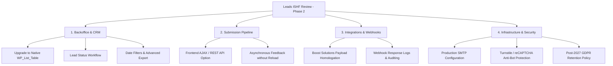

# International Social Housing Festival 2027 (ISHF 2027)

Standalone Base Theme for the official website of the **International Social Housing Festival 2027**, hosted in Lisbon, Portugal (7–9 June 2027). Built with **UIkit 3** and strict **WCAG 2.1 AA Accessibility Standards**.

---

## Architecture & Features

### 1. Standalone Base Theme (Parent Theme)
- Fully self-contained base theme (`style.css` declares `Theme Name: ISHF 2027` without a `Template:` dependency).
- Independent root template files: `header.php`, `footer.php`, `index.php`, `page.php`, `page-under-maintenance.php`.
- Core base constants: `BASE_SITE`, `BASE_CSS`, `BASE_IMAGES`, `BASE_BRANDING`, `BASE_ASSETS`, `BASE_FAVICONS`, `BASE_JS`, `BASE_FONTS` (with backwards-compatibility aliases `CHILD_BASE_*`).
- Self-contained textdomain loading (`load_theme_textdomain(TEXT_DOMAIN, ...)`).

### 2. UIkit 3 Framework Compliance & Button System
- Built strictly on UIkit 3 (`getuikit.com`).
- Standard UIkit components: `uk-navbar`, `uk-sticky`, `uk-grid`, `uk-container`, `uk-card`, `uk-form-stacked`, `uk-alert`, `uk-button`.
- **UIkit Button Hierarchy**:
  - `.uk-button`: Base styles (font, 48px height, rounded corners, transitions, flex alignment).
  - `.uk-button-primary`: Brand sunny yellow action button with blue text and elevation on hover.
  - `.uk-button-secondary`: Brand city forest green action button with white text and elevation.
  - `.uk-button-default`: Outline / neutral button with automatic Light/Dark mode border adaptation.
  - `.uk-button-danger`: Alert / destructive action button (Lisbon red).
  - `.uk-border-pill`: Pill border-radius utility for brand-aligned CTAs.
  - `.uk-button-small` (36px) & `.uk-button-large` (52px): Standard size modifiers.

### 3. Design Tokens & CSS Variable Architecture
- **Palette & RGB Channels**: All core brand and neutral colors define both HEX and RGB channel tokens (`--colors-*-rgb`) to support dynamic alpha compositing via `rgba(var(...), alpha)`.
- **Zero Hardcoded Colors**: Colors throughout the stylesheet strictly consume custom properties (`var(--...)`).
- **Semantic Light/Dark Mode Tokens**:
  - Backgrounds, typography, borders, and inputs adapt seamlessly using `html.dark-mode` semantic overrides.
  - Dedicated component tokens for Theme Toggle (`--toggle-*`), CTA Boxes (`--cta-*`), and UIkit Buttons (`--btn-*`).
- **Consolidated Media Queries** (aligned with UIkit breakpoints, at the end of `css/app.css` and `css/app.min.css`):
    - Small / mobile: `@media (max-width: 639.98px)`
    - Medium / tablet: `@media (min-width: 640px) and (max-width: 959.98px)`
    - Large: `@media (min-width: 960px)` (UIkit `@m` starts here); large only: 960px to 1199.98px
    - XLarge: `@media (min-width: 1200px)`
    - XXLarge: `@media (min-width: 1600px)`
    - Reduced motion: `@media (prefers-reduced-motion: reduce)` (WCAG 2.1 AA)
- **Design System v2 tokens**: type scale 62/44/32/26/20/16 (mobile and tablet overrides in the media queries), radius sm/md/lg/pill, spacing 4 to 120, neutral and night palettes. `--colors-border-default` is decorative only; controls use `--colors-border-strong` (WCAG 1.4.11).

### 4. WCAG 2.1 AA Accessibility (a11y)
- **Skip Link**: `<a href="#content-start" class="skip-link">` provides instant keyboard access to main content.
- **Landmarks**: `<header role="banner">`, `<nav role="navigation">`, `<main id="content-start" role="main" class="site-main" tabindex="-1">`, `<footer role="contentinfo">`, and `<div role="region">`.
- **Forms**: All inputs have explicit `<label for="...">` associations, `aria-required="true"`, `aria-describedby`, and validation alerts with `role="alert"` / `role="status"`.
- **Theme Switch**: Implemented with `role="switch"` and dynamic `aria-checked` state updates (60x32 pill, sun and moon visible, used in the nav and the footer).
- **Language Switch (WPML)**: `includes/language-switcher.php` renders the active WPML languages with `lang`, `hreflang` and `aria-current`; prints nothing if WPML is inactive.
- **Layout variants**: `ishf_use_full_layout(true)` (set by index, page, single, archive, category and search) loads the full navigation-menu (links, language switch, off-canvas on mobile) and footer. Landing page, 404 and maintenance keep the minimal ones.
- **Focus Rings**: Universal `:focus-visible` ring: Blue Sky in Light mode, Sunny Yellow (`#F2A536`) in Dark mode and on navy surfaces (footer, cookie bar, off-canvas).
- **Reduced Motion**: Respects `prefers-reduced-motion: reduce` preference across all animations and transitions.
- **Contrasts**: High contrast ratios (AAA on institutional blue `#023256`, AA/AAA across text and buttons).

### 5. Dual Strategy: Launch Landing Page vs Master Festival Edition
- **`page-landing-page.php` (Slug: `landing-page`)**:
  - Dedicated launch landing page template designed for lead acquisition ahead of the full festival reveal.
  - Automatically loaded by the WordPress template hierarchy for pages with the `landing-page` slug (no manual template selection required in the backoffice).
  - Minimalist layout containing sticky navigation with adaptive key icon, side-by-side logo & claim, conditional Streaming Event block (`includes/sections/streaming.php`), side-by-side dual CTA forms (Call for Sessions & Partnerships), dedicated newsletter section, and minimal legal footer.
- **`index.php` (Master Homepage for Final Edition)**:
  - Liberated to serve as the full-fledged festival portal.
  - Modularly orchestrates:
    - `includes/sections/header.php` (Sticky navigation & hero showcase)
    - `includes/sections/streaming.php` (Live / recorded streaming event block — rendered automatically when the `sections/streaming` or `streaming` WP page is published)
    - `includes/sections/about.php` (4 core festival pillars)
    - `includes/sections/program.php` (3-day interactive schedule with UIkit switcher)
    - `includes/sections/speakers.php` (Keynote speakers & panelists grid)
    - `includes/sections/ctas.php` (Dual call for sessions & partnership engagement)
    - `includes/sections/newsletter.php` (Dedicated newsletter section)
    - `includes/sections/sponsors.php` (Institutional partners & supporters)
    - `footer.php` (Consolidated accessible legal footer & closing scripts)

### 6. Template Suite & Future Readiness
- `404.php`: Accessible error page with UIkit layout, horizontal adaptive logo, gradient 404, and return button.
- `page-under-maintenance.php` (Slug: `under-maintenance` / `page-manutencao.php`): Under maintenance page with UIkit animations, rotating gear, and branding, automatically resolved by the corresponding page slug.
- `search.php`: Search results page with responsive UIkit cards and pagination.
- `single.php`: Article template with metadata, featured image gallery, and article navigation.
- `category.php` & `archive.php`: Archive listings for categories, tags, authors, and dates.
- `page.php`: Standard internal content page.
- `page-google-sitemap.php`: Dynamic XML sitemap generator for SEO.
- `page-ics-generator.php`: Calendar invite generator (.ics) for festival dates and sessions.

### 7. Light / Dark Mode Toggle
- `includes/theme-toggle.php` & `js/light-dark-switch.js`: Accessible theme switch maintaining cookie and localStorage preference.
- Inline anti-FOUC script on `wp_head` (priority 5).
- Adaptive logo switching via `.light-mode-img` and `.dark-mode-img`.

---

## Form Handlers & Boost Solutions Webhook API Integration

Submissions are processed locally in `includes/form-handlers.php` on the `wp_loaded` hook and dispatched via `wp_remote_post` to the Boost Solutions Webhook API:

- **Endpoint**: `NEWSLETTER_API_ENDPOINT` (`https://api-mm.boostsolutions.pt/api/webhooks/gravity-forms`)
- **Configurable tokens in `functions.php`**:
  - `PARTNERSHIP_PROJECT_TOKEN`: Project token for partnership inquiries.
  - `NEWSLETTER_PROJECT_TOKEN`: Project token for newsletter subscriptions.

### API Payload Field Structure (JSON Body)

All fields are formatted strictly as **Strings**:

| API Field | Type | Partnership Form (`partnership`) | Newsletter Form (`newsletter`) |
| :--- | :--- | :--- | :--- |
| `email_address` | String | Submitted email address | Submitted email address |
| `title` | String | `''` *(empty by default)* | `''` *(empty by default)* |
| `first_name` | String | First name extracted from full name | First name extracted from full name |
| `middle_name` | String | Middle name(s) extracted *(or empty)* | Middle name(s) extracted *(or empty)* |
| `last_name` | String | Last surname extracted | Last surname extracted |
| `full_name` | String | Full name entered | Full name entered |
| `function` | String | Job title / role entered (`partnership_position`) | `''` *(not applicable to this form)* |
| `company` | String | Company / organization entered (`partnership_company`) | `''` *(not applicable to this form)* |
| `phone` | String | Phone number entered (`partnership_phone`) | `''` *(not applicable to this form)* |
| `consent` | String | `'1'` *(confirmed GDPR authorization)* | `'1'` *(confirmed GDPR authorization)* |
| `message` | String | Partnership inquiry message text | `''` *(not applicable to this form)* |
| `project_token` | String | `PARTNERSHIP_PROJECT_TOKEN` | `NEWSLETTER_PROJECT_TOKEN` |

> [!WARNING]
> **TODO - Partnership Message Field (`message`)**:
> Validate with the Boost Solutions API / Webhooks team whether the payload accepts the `'message'` key directly or requires a different identifier (e.g., `'notes'`, `'comments'`, `'description'`).

### Name Parsing Logic
The system automatically splits the submitted full name into components:
- **`first_name`**: First word of the name.
- **`last_name`**: Last word of the name (when 2 or more words exist).
- **`middle_name`**: All intermediate words joined by spaces.
- **`full_name`**: Original trimmed full string.

### API Resilience & Error Alerts
1. **Guaranteed Email Notification**:
   - In addition to the external webhook, each submission sends an HTML-formatted notification email to the festival secretariat (`SITE_CONTACT_EMAIL` / `SITE_CONTACT_EMAIL_2`), ensuring no lead is lost even during temporary external API outages.
2. **Technical Failure Alerts**:
   - Following the Boost Solutions monitoring pattern, if the webhook returns `is_wp_error` or an HTTP status code outside the `200..299` range, an automated technical alert email is dispatched to `boostwebdesign@medialivre.pt`.

### Dual CTAs Block Structure (`includes/sections/ctas.php`)
- **CTA 1 (Left Column) - Call for Sessions**:
  - Presents the invitation to participate in the festival programme with the official copy:
    *"Help shape the programme of ISHF Lisbon 2027: submit your proposal for a session, debate or workshop and share your ideas on the future of social and affordable housing."*
  - Includes visual highlights for the three proposal formats (*Sessions & Debates*, *Workshops & Labs*, *Projects & Ideas*).
  - The submission button redirects to the external form via the dedicated helper `ishf_get_call_for_sessions_url()`, configurable directly via the `SITE_CALL_FOR_SESSIONS_URL` constant in `functions.php` or the `'ishf_call_for_sessions_url'` WordPress filter.
- **CTA 2 (Right Column) - Institutional Partnerships with Modal Popup (`#modal-partnership`)**:
  - The partnership card displays a concise summary with a *"Become a Partner"* button that opens a native UIkit modal (`#modal-partnership`), following the reference architecture of `marketing-stars` and `uikit-boostsolutions`.
  - The modal header features the themed `.cta-badge-partnership` badge with consistent styling (high-contrast adaptive amber pill with border for both Light Mode and Dark Mode).
  - Includes all corporate contact fields (Full Name, Email, Company, Job Title, Phone, Message, and GDPR Consent).
- **Dedicated Newsletter Block (`includes/sections/newsletter.php`)**:
  - The newsletter subscription form resides in its own dedicated section below the primary CTAs, sharing the same visual language, accessibility standards, and validation pipeline.

---

## Native Leads Management (Custom Database, AJAX Endpoints & Backoffice)

To ensure maximum performance, security, and a clean client handover without relying on heavy third-party form plugins (e.g., Gravity Forms or Contact Form 7), the theme implements a complete, self-contained data management system in `includes/leads-manager.php`:

### 1. Custom Database Tables (`dbDelta`)
Created and maintained automatically via the native WordPress `dbDelta` utility:
- **`wp_ishf_partnerships`**:
  - `id` (bigint, autoincrement, primary key)
  - `nome` (varchar 255)
  - `email` (varchar 255, indexed)
  - `empresa` (varchar 255)
  - `cargo` (varchar 255)
  - `telefone` (varchar 50)
  - `mensagem` (text)
  - `gdpr_consent` (tinyint 1)
  - `created_at` (datetime, indexed)
- **`wp_ishf_newsletter`**:
  - `id` (bigint, autoincrement, primary key)
  - `nome` (varchar 255)
  - `email` (varchar 255, indexed)
  - `gdpr_consent` (tinyint 1)
  - `created_at` (datetime, indexed)

> [!NOTE]
> **Transparent Migration & Updates**: The database schema is versioned via `ISHF2027_DB_VERSION` (`'1.0.0'`). Tables are created on the `after_switch_theme` hook and verified on `admin_init`, ensuring they are provisioned immediately when visiting the admin dashboard without needing to deactivate and reactivate the theme.

### 2. Secure Submission Endpoints (AJAX & REST API)
- **WordPress AJAX Endpoints**:
  - `wp_ajax_nopriv_ishf2027_partnership_submit` & `wp_ajax_ishf2027_partnership_submit`
  - `wp_ajax_nopriv_ishf2027_newsletter_submit` & `wp_ajax_nopriv_ishf2027_newsletter_submit`
- **WordPress REST API Routes**:
  - `POST /wp-json/ishf2027/v1/partnerships`
  - `POST /wp-json/ishf2027/v1/newsletter`
- **Security & Sanitization Mechanisms**:
  - Strict Nonce validation (`check_ajax_referer` / `wp_verify_nonce`).
  - Deep sanitization via `sanitize_text_field(wp_unslash(...))`, `sanitize_email(...)`, and `sanitize_textarea_field(...)`.
  - Parameterized `$wpdb->insert` queries with explicit format specifiers (`%s`, `%d`).
  - Structured JSON responses (`wp_send_json_success` and `wp_send_json_error`).

### 3. Granular Field-by-Field Validation & Visual Feedback (`.uk-form-danger`)
- **Field-Specific Validation**: Instead of generic error messages, the system validates each input individually:
  - **Full Name**: Required field (`Full Name is required.`).
  - **Work Email**: Presence and strict RFC format validation via `is_email()` (`Please provide a valid email address.`).
  - **Company / Organization**: Required field (`Company / Organization is required.`).
  - **Job Title / Role**: Required field (`Job Title / Role is required.`).
  - **GDPR Consent**: Boolean checkbox validation (`You must authorize data processing to submit this form.`).
- **Accessible Visual Highlighting**: Invalid fields automatically receive the `.uk-form-danger` class (soft red border and background in Lisbon Red `#CE4638` in Light Mode and `#F87171` in Dark Mode), accompanied by descriptive inline error messages (`.uk-text-danger`).
- **Input Preservation**: Validated field values are preserved in the form after submission, preventing data loss and user frustration.
- **Automatic Modal Reopening**: The template includes an inline script in `includes/sections/ctas.php` that automatically reopens the modal (`UIkit.modal('#modal-partnership').show()`) upon submission errors or success.

### 4. Native Processing & Duplicate Prevention (Idempotency)
- The submission workflow is executed cleanly by the native pipeline in `includes/form-handlers.php`, ensuring only the official template success message is displayed (with no duplicate alerts).
- **Anti-Duplication Idempotency Window**: Database insertion helpers (`ishf2027_insert_partnership_lead` and `ishf2027_insert_newsletter_lead`) enforce a 60-second deduplication check per email address, preventing double-clicks or page refreshes (F5) from creating duplicate records in the admin dashboard.

### 5. Concurrent External Webhook Integration & Resilient Delivery
Each valid submission executes three decoupled actions:
1. **Local Database Persistence** (`wp_ishf_*` tables).
2. **Boost Solutions Webhook Dispatch** (`https://api-mm.boostsolutions.pt/api/webhooks/gravity-forms`) using `PARTNERSHIP_PROJECT_TOKEN` and `NEWSLETTER_PROJECT_TOKEN`.
3. **Decoupled Email Notification (`@wp_mail`)**: Email delivery to the Secretariat (`SITE_CONTACT_EMAIL`) runs non-blockingly, ensuring that even in local environments without an active SMTP server or during temporary mail network glitches, database persistence and Boost Solutions API delivery are never aborted.

### 6. Backoffice Dashboard ("Leads ISHF")
- Top-level admin menu (`dashicons-groups`) and submenu shortcut under Dashboard (`index.php`).
- Separate navigation tabs for *Institutional Partnerships* and *Newsletter Subscriptions*.
- Real-time numeric counters in tab headers.
- Native `wp-list-table widefat fixed striped` table with visual GDPR status badges (`✓ Yes` / `✕ No`) and WordPress-formatted timestamps.

### 7. CSV Export (Excel Ready)
- Dedicated *"Export to CSV"* button on each tab (`admin_post_ishf2027_export_csv`).
- Protected by `current_user_can('manage_options')` and `check_admin_referer`.
- Includes a **UTF-8 BOM** (`\xEF\xBB\xBF`) and semicolon `;` delimiter, guaranteeing seamless opening in Microsoft Excel with full support for international characters and accents.

### 8. Phase 2 Specification & Roadmap (Leads ISHF Evolution)

For **Phase 2 of the ISHF Lisbon 2027 portal**, this section documents the current maturity state of the **Leads ISHF** module, the technical trade-offs adopted in Phase 1, and the detailed implementation plan for future enhancements:

#### 8.1. Current State in Phase 1 (Foundation & Stability)
- **Zero Plugin Dependency**: 100% tailor-made, lightweight, secure, and high-performance system without heavy third-party plugins (Gravity Forms, CF7, etc.).
- **Native Server-Side Processing**: Submissions processed via traditional POST in `includes/form-handlers.php` on the `wp_loaded` hook. This approach was deliberately chosen to guarantee 100% resilience and avoid submission duplication or failures caused by browser script blockers.
- **Idempotency (Anti-Duplication)**: 60-second deduplication window per email on database insertion, preventing duplicate records from double-clicks or page refreshes (F5).
- **Granular & Accessible Validation**: Field-by-field validation with `.uk-form-danger` visual alerts (Lisbon Red with WCAG 2.1 AA contrast in both Light and Dark Mode), inline `.uk-text-danger` messages, input retention, and automatic modal reopening (`UIkit.modal('#modal-partnership').show()`).
- **Decoupled Integrations**: Non-blocking Secretariat email dispatch (`@wp_mail`), atomic local `$wpdb` storage, and concurrent webhook delivery to the Boost Solutions API.
- **Control Panel**: Standalone *"Leads ISHF"* admin menu with dynamic tabs, real-time counter badges, and Microsoft Excel-ready CSV export (UTF-8 with BOM and `;` delimiter).
- **Ready-to-Use REST API Endpoints**: Routes `/wp-json/ishf2027/v1/partnerships` and `/wp-json/ishf2027/v1/newsletter` already registered and validated in `includes/leads-manager.php`.

---

#### 8.2. Phase 2 Priority Checklist & Tasks



##### 1. Backoffice Upgrade to Native `WP_List_Table` Class
- **Dynamic Pagination**: Replace direct listing with configurable native pagination (e.g., 20, 50, 100 items per page) via *Screen Options*.
- **Full-Text Search**: Quick search input above the table to filter by name, email, company, phone, or message using parameterized `$wpdb->prepare` queries.
- **Sortable Columns**: Allow ascending/descending sorting by ID, Name, Company, Email, and Registration Date.
- **Bulk Actions**: Multi-select checkboxes to bulk-delete records or update processing statuses.

##### 2. Partnership Mini-CRM & Lead Status Management
- **Status Column**: Add `status varchar(30) NOT NULL DEFAULT 'new'` to the `wp_ishf_partnerships` table:
  - `new` (*New lead - awaiting triage*)
  - `in_review` (*Under review by the secretariat*)
  - `contacted` (*Initial institutional contact made*)
  - `meeting_scheduled` (*Partnership meeting scheduled*)
  - `proposal_sent` (*Proposal / sponsorship deck sent*)
  - `confirmed` (*Partnership closed and confirmed*)
  - `archived` (*Archived / No interest*)
- **Internal Notes**: Add `notes text NULL` column for the festival team to log historical meeting notes and decisions.
- **Quick AJAX Status Update**: Interactive dropdown in the backoffice table to update lead status without reloading the page.

##### 3. Advanced Filtering & Segmentation in CSV Export
- **Date Range Filter**: Start date (`start_date`) and end date (`end_date`) pickers on the CSV export screen.
- **Status Filter**: Ability to export leads filtered by specific statuses (e.g., only `"confirmed"` or only `"new"` leads).
- **Scheduled Reports**: Optional periodic CSV email delivery (e.g., weekly or biweekly) to festival management via WP-Cron.

##### 4. Frontend Submission Pipeline: POST vs AJAX/REST Evaluation
- **Requirements Analysis**: The current form operates with full stability via POST and automatic modal reopening. If 100% asynchronous submission (without page refresh) is required in Phase 2:
  1. Consume the existing endpoints: `/wp-json/ishf2027/v1/partnerships` and `/wp-json/ishf2027/v1/newsletter`.
  2. Implement a dedicated JavaScript module (`js/leads-rest.js`) that intercepts the `submit` event, calls `e.preventDefault()`, and disables the button with a loading state (`UIkit.spinner`).
  3. Validate the JSON response and display success feedback or highlight invalid fields with `.uk-form-danger` in real time.
  4. After a successful submission, smoothly close the modal after 2.5 seconds via `UIkit.modal('#modal-partnership').hide()`.

##### 5. Payload Homologation with the Boost Solutions API
- **`message` Field Validation**: Confirm with the Boost Solutions backend team whether the `'message'` key in the JSON payload maps directly in Mail Manager / Gravity Forms or requires mapping to `'notes'`, `'comments'`, or a custom field (`input_*`).
- **Webhook Logs Table**: Optionally create a `wp_ishf_webhook_logs` table to record the returned HTTP status code and external server response for each dispatch, enabling a manual *retry button* in the backoffice if the external API is temporarily unreachable.

##### 6. Transactional Email Infrastructure (Production SMTP)
- **Authenticated Mail Servers**: On the Medialivre production server, configure SMTP delivery via PHPMailer / `wp_mail_smtp` using the group's authorized mail servers.
- **DNS Validation**: Ensure the `@ishf2027.pt` domain has properly configured SPF, DKIM, and DMARC records so notifications to `secretariado@ishf2027.pt` never land in spam folders.

##### 7. Anti-Bot Security & Rate Limiting
- **Invisible Protection**: Enable Google reCAPTCHA v3 or Cloudflare Turnstile using the `RECAPTCHA_SITE_KEY` and `RECAPTCHA_SECRET_KEY` constants already defined in the theme configuration.
- **Accessible Honeypot Field**: Include a hidden field for human users with `.uk-visually-hidden` that silently aborts submission if populated by bots.
- **Rate Limiting**: Limit submissions to a maximum of 5 attempts per IP every 10 minutes to mitigate injection attacks or automated spam.

##### 8. GDPR Compliance & Post-Festival Data Retention
- **Lead Lifecycle**: Establish with the Legal department the personal data purge schedule (e.g., 12 to 24 months after the festival takes place in June 2027).
- **Purge / Anonymization Routine**: Scheduled WP-Cron job to purge or anonymize sensitive fields (`nome`, `email`, `telefone`), preserving only aggregated statistical records for event history.

---

## Disclaimers & Unified GDPR Consent Statement

To simplify management and legal review, the GDPR consent statement is unified in `functions.php`:

- **Central Constant**: `SITE_DEFAULT_CONSENT_DISCLAIMER`
  ```text
  "I expressly authorize the processing of my personal data for marketing communications by Medialivre, S.A. and its partner entities, via telephone, email, SMS, and postal mail."
  ```
- **Child Constants**: `SITE_PARTNERSHIP_CONSENT_DISCLAIMER` and `SITE_NEWSLETTER_CONSENT_DISCLAIMER` inherit the unified statement by default.
- **Filterable Helper Functions**:
  - `ishf_get_partnership_disclaimer()`: filterable via `'ishf_partnership_consent_disclaimer'`.
  - `ishf_get_newsletter_disclaimer()`: filterable via `'ishf_newsletter_consent_disclaimer'`.

## Accessibility & Contrast Fixes (WCAG 2.1 AA / AAA)

1. **Explicit `<h1>` Declaration on the Landing Page**:
   - Added an explicit accessible `<h1>` (`.sr-only .uk-screen-reader-text`) inside the primary `<main id="content-start">` landmark in `page-landing-page.php` and `index.php`.
   - The header claim uses `role="heading" aria-level="2"` with the `.header-claim` class, preserving an intact H1 -> H2 heading hierarchy without duplicate `<h1>` elements.

2. **Skip-Link (AAA Contrast 13.16:1)**:
   - Configured with dark brand blue background (`var(--colors-brand-blue-sky)` - `#023256`), white text (`#FFFFFF`), sunny yellow border (`#F2A536`), and `#022540` focus/hover state.
   - Passes with a contrast ratio above 13:1 (AAA level).

3. **Newsletter Form Button (AA Contrast 6.62:1)**:
   - Secondary/success action tokens with white text on forest green background were tuned to `#2E685D` (hover `#224F46`), raising the contrast ratio from 3.91:1 (AA fail) to 6.62:1 (comfortable AA pass and AAA pass for large text).

4. **Footer Separator (`|`)**:
   - Declared with `#FFFFFF` color (`var(--colors-neutral-white) !important`) and `aria-hidden="true"` to ensure crisp visual separation without screen reader noise.

5. **Explicit Page Title in `<head>` (`<title>` - WCAG 2.4.2 / WAVE)**:
   - Explicitly declared an informative `<title>` tag in `header.php`, eliminating the WAVE *"Missing or uninformative page title"* error.
   - Uses `SITE_SHORT_NAME` (`ISHF 2027`) and the official festival claim:
     `<title>ISHF 2027 | Cities with Soul: It Begins with a Key</title>`.

---

## Cookie Consent Banner (`#cookies-disclaimer`)

Implemented according to the standard UIKit Boost Solutions architecture and the reference styles of the `marketing-stars` project:

1. **Template Integration (`footer.php` & `header.php`)**:
   - Conditionally integrated via the `SITE_COOKIES_DISCLAIMER_POSITION` constant (set to `'top'`).
   - Automatically suppressed on maintenance pages (`is_page('manutencao')` or `page-under-maintenance.php`) and widget views.

2. **Cookie Policy Page Resilience & Fallback**:
   - Looks up the `'cookie-policy'` slug first and falls back to `'politica-de-cookies'`.
   - If the page has not yet been created or published in the WordPress backoffice during development, the banner remains visible and functional with a fallback link to `REDIRECT_SITE . '/cookie-policy/'`.

3. **Script Dependencies (`js/cookies.js`)**:
   - Enqueued in `functions.php` with `array('jquery', 'uikit')` dependencies.
   - Sets the `ISHF_2027_Cookie_Accept` cookie and collapses the banner using native UIkit animation (`UIkit.toggle`).

4. **Dedicated CSS Styles (`css/app.css` & `css/app.min.css`)**:
   - Deep ocean blue background (`var(--colors-brand-blue-sky)` - `#023256`), adapting to `var(--colors-neutral-gray-900)` in Dark Mode.
   - Pure white text (`#FFFFFF`) and links highlighted in sunny yellow (`var(--colors-brand-sunny-yellow)` - `#F2A536`) with accessible underline.
   - `#btnAcceptCookies` button styled as a pill `.uk-button-primary` (`border-radius: 50px`), yellow with blue text and high-contrast hover state.

---

## Event Streaming Block, YouTube Video Templates & Shortcodes (`includes/sections/streaming.php`)

Implemented following the standard **`uikit-boostsolutions`** architecture, enabling live broadcasts or recorded sessions to be displayed on both the Launch Landing Page (`page-landing-page.php`) and the Master Homepage (`index.php`), as well as on any other occasion via dedicated WordPress pages.

### 1. Reusable YouTube Video Templates (`uikit-boostsolutions` Pattern)
1. **Inline Embed (`includes/video-youtube-embed.php`)**:
   - Consumes the global variables `global $youtube_id, $autoplay, $youtube_title;`.
   - Renders a responsive 16:9 `<iframe width="1920" height="1080" data-uk-responsive>` with `referrerpolicy="no-referrer-when-downgrade"`, `loading="lazy"`, and an accessible `title` attribute (WCAG 4.1.2).
2. **Modal Popup (`includes/video-youtube-modal.php`)**:
   - Consumes the global variables `global $youtube_id, $modal_id, $auto_fire, $youtube_title;`.
   - Renders a centered UIkit modal dialog (`data-uk-modal`) with an accessible close button (`data-uk-close`).
   - **Dynamic Playback Lifecycle (`shown` / `hidden`)**: The `<iframe>` `src` is injected with `autoplay=1` only when the modal opens (`UIkit.util.on('#...', 'shown')`) and cleared (`src=""`) immediately when the modal closes (`hidden`), ensuring audio/video never continues playing in the background.
   - Supports automatic modal opening on page load when `$auto_fire = true` (`UIkit.modal('#...').show()`).

### 2. 100% WordPress Page-Driven Streaming Section (`includes/sections/streaming.php`)
The streaming block contains no hardcoded event text or video IDs in the template: all of its content is defined inside the WordPress page (`sections/streaming` or `streaming`), allowing the block to be reused across multiple occasions:

| Block Element | Source in the WordPress Page (`sections/streaming` or `streaming`) |
| :--- | :--- |
| **Visibility (On / Off)** | The block is rendered only when the page exists, has **`publish`** status, and contains a valid `[youtube]` shortcode. Switching the page to *Draft* automatically hides the section. |
| **Title (`<h2>`)** | **1.** If a Heading block (`H2`/`H3`) is present inside the page content, `uikit_cbs_get_post_headings()` extracts that first heading as the block title and `uikit_cbs_remove_post_headings()` removes it from the body content to prevent duplication.<br>**2.** Otherwise, it uses the **WordPress Page Title (`post_title`)** directly. |
| **Description / Intro Copy** | All paragraphs and blocks written in the page editor are rendered inside `.streaming-intro` (with the `[youtube]` shortcode automatically stripped from the text via `uikit_cbs_strip_shortcode()`). |
| **Badge Pill (`Live Stream`)** | Uses the page **Excerpt (`post_excerpt`)** or the `badge="..."` attribute on the `[youtube]` shortcode, defaulting to `"Live Stream"`. Includes a pulsing `.streaming-live-dot` indicator (Lisbon Red). |
| **Video & Mode (`embed` / `modal`)** | Defined by the `[youtube]` shortcode placed in the page content:<br>• **Inline Embed (default)**: `[youtube id="YOUTUBE_ID_OR_URL"]` (optional: `autoplay="true"`).<br>• **Modal Popup**: `[youtube id="YOUTUBE_ID_OR_URL" mode="modal" button_text="Watch Live Stream"]` (optional: `auto_fire="true"`). |
| **Poster Image (Modal Mode)** | Uses the page's **Featured Image** (`image-gallery` / `large`), automatically falling back to the high-resolution YouTube thumbnail (`maxresdefault.jpg`). |

### 3. Reusing the Block Across Multiple Occasions or Sessions
In addition to its default behavior reading `sections/streaming` (or `streaming`), the same block can be included multiple times pointing to different WordPress pages (automatically generating unique section and modal IDs per page):

- **Via PHP (`get_template_part`)**:
  ```php
  // Default behavior (reads the 'sections/streaming' or 'streaming' page)
  get_template_part('includes/sections/streaming');

  // Reused for another session or occasion from a specific page
  get_template_part('includes/sections/streaming', null, array(
    'page_path' => 'sections/streaming-closing-session',
  ));
  ```
- **Via Shortcode (`[streaming]` or `[streaming-event]`)**:
  ```text
  [streaming]
  [streaming page_path="sections/streaming-closing-session"]
  [streaming page_id="125" mode="modal"]
  ```

### 4. Helper Functions & Shortcodes Initialized in `functions.php`
Following the `uikit-boostsolutions` function library:
- **Content & Block Extraction / Manipulation**:
  - `uikit_cbs_get_post_groups($postID, $rendered = true)` (alias `ishf_get_post_groups`)
  - `uikit_cbs_get_post_headings($postID)` (alias `ishf_get_post_headings`)
  - `uikit_cbs_remove_post_headings($postID, $position = -1)` (alias `ishf_remove_post_headings`)
  - `uikit_cbs_strip_shortcode($content, $shortcode_tag)` (alias `ishf_strip_shortcode`)
- **Video Shortcode Extraction**:
  - `uikit_cbs_get_post_youtubes($post, $html = true)` (alias `ishf_get_post_youtubes`)
  - `uikit_cbs_get_post_youtube_atts($post)` (alias `ishf_get_post_youtube_atts`)
  - `uikit_cbs_get_post_brightcoves($post, $html = true)` (alias `ishf_get_post_brightcoves`)
- **Security / Referrer Policy Filter**:
  - `uikit_cbs_youtube_add_referrerpolicy()` hooked into `embed_oembed_html` and `video_embed_html`.
- **Registered Shortcodes**:
  - `[youtube]` (`shortcode_youtube()`): Supports `id` (11-character ID or full YouTube URL), `title`, `title_size`, `title_position`, `no_margin`, `list`, `mode`, `autoplay`, `auto_fire`, `badge`, and `button_text`.
  - `[brightcove]` (`shortcode_brightcove()`): Responsive Brightcove player compatible with `uikit-boostsolutions`.
  - `[streaming]` / `[streaming-event]` (`shortcode_streaming_event()`): Renders the `includes/sections/streaming.php` block inside any page or post.

---

## Agent Rules & Guidelines
- Architectural guidelines and accessibility standards are codified in `.agents/rules/ishf-uikit-accessibility.md`.
